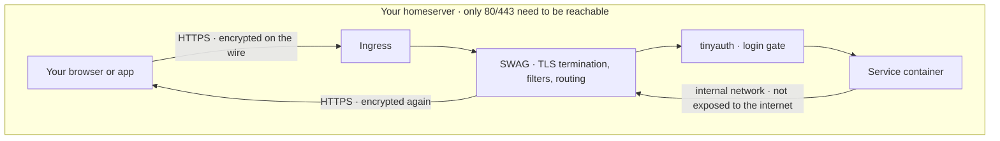
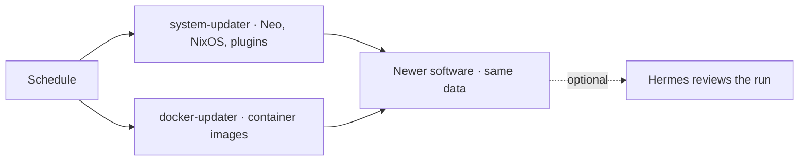
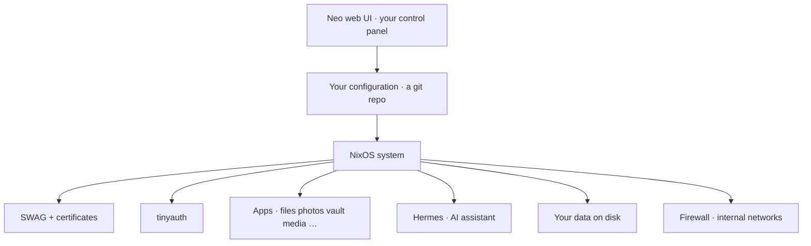
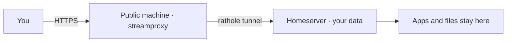

# How Neo works

This page explains the homeserver in plain language. Product pitch: [../README.md](../README.md). Install steps: [INSTALL.md](INSTALL.md).

Deep packaging detail for contributors lives in [AGENTS.md](../AGENTS.md). You do not need that to *use* Neo.

## The idea

Neo runs **all of your services on one machine you control**. You manage day-to-day life in the **web UI**: turn apps on, set domain and users, apply changes. Under the hood, NixOS keeps the system **reproducible** (same config → same result), **revertible** (bad update? go back), and **recoverable** (config + data you can restore).

Opinionated defaults mean security and HTTPS are not a homework assignment.

## Communication (the important picture)

From your phone or laptop to an app and back:

**Ingress** is either:

- your machine's **public IP**, or
- **streamproxy** on a public machine that forwards to your homeserver

From your side it is still "HTTPS to my domain".

### What that means for privacy and ownership

| Step | What happens |
|------|----------------|
| On the internet | Traffic is **encrypted (TLS)**. Passers-by and random servers do not see your content in the clear. |
| At the front door | **SWAG** (Nginx with automatic Let's Encrypt certificates) decrypts. It can drop visitors from countries or IP ranges you block, and ban IPs that keep failing (fail2ban). |
| The login | **tinyauth** asks who you are, then checks that you may open this app. Many apps also have **their own login**, so almost everything has two locks. |
| Between apps | Services talk on an **internal** network. They are not each hanging on a public port. |
| Back to you | The response is **encrypted again** before it leaves the server. |

You only need to expose **ports 80 and 443**. Nothing else is required for normal web access. The box can sit at home. It does not need to "be the whole internet"; it needs a path for those two ports (direct or via streamproxy).

## Logins and users

| Piece | Job |
|-------|-----|
| **tinyauth** | The login in front of every app. Local users (password, optional TOTP) and any number of OAuth providers (Authentik, Google, Microsoft Entra ID, …). Decides per person or per group which apps they may open. |
| **Authentik** (optional) | A full identity provider on your own machine. Tinyauth can use it as an OAuth provider, and apps can use it directly for OIDC, SAML or LDAP. |
| **App single sign-on** | Some apps sign you in from the tinyauth login, so there is no second password. Docmost is one. |

Each service also chooses where it can be reached (`ingress`): on the **LAN**, on **Tailscale**, on the **public web**, or any mix.

## Automatic updates

- **system-updater** runs `neo update` and then activates the new system on a schedule (default 04:00). It can switch live, or only set the next boot and restart the machine. It also cleans out old builds.
- **docker-updater** pulls newer container images (default Sundays 04:00) and restarts only the containers whose image changed. It keeps the previous image so a bad update can be rolled back.
- **Hermes** (optional, `superviseUpdates`) reads the logs after an update that changed something. If a container broke, it rolls that container back and tells you. It never rolls back the system on its own.

Combined with Nix rollbacks, updates are something Neo does *for* you, not a second job.

## Going back

| What | Where | What it restores |
|------|-------|------------------|
| **Generations** | Web UI → Versioning | The whole system configuration. Switch now, or boot into an older one. Your data is not touched. |
| **Service snapshot** | Service page → Snapshots | One service's data. The other services keep running. |
| **Data snapshot** | Web UI → Versioning → Data snapshots | All Neo data and the config repo. The machine restarts. A restore can be undone. |
| **Off-site backup** | `backup` service | A copy of your data on another machine (rsync over SSH, on a schedule). |
| **Config repo** | `neo restore <repo>` on a new machine | The whole machine configuration, including its SSH host key and (encrypted) secrets, from git. Data comes from backups. See [Rebuild a machine](INSTALL.md#rebuild-a-machine-from-its-config-repo). |

Snapshots need the default ZFS disk layout ([Disko](INSTALL.md#automatic-disk-layout-disko)).

## One thing at a time

Some actions must not overlap: an activation, an update, a restore, a restart. Neo takes a **lock** for each one. While one runs, buttons that would clash are greyed out, and a clashing command says what is running instead. Locks clear themselves when the job ends, even after a crash.

## What's on the machine (simple map)

- **Neo web**: where normal users spend their time. Saved edits wait as pending changes until you apply them; each activation is a commit in your configuration repo, so you can see what changed and go back.
- **Apps**: open source services you enable. They store data under Neo's volume layout on *your* disks.
- **Hermes**: an AI assistant that knows each enabled service and can operate the machine for you. You choose the AI provider.
- **Plugins**: optional packs of extra apps or Nix bits ([PLUGINS.md](PLUGINS.md)). Same security front door.

## Streamproxy (no public IP at home)

If the homeserver cannot accept 80/443 from the internet (CGNAT, locked router, …):

DNS still points at the **public** side. Streamproxy does not decrypt anything; it passes the encrypted traffic through. Your **data stays on the homeserver**. You need a working tunnel (rathole) and a matching streamproxy entry. See [INSTALL.md](INSTALL.md#no-public-ip-streamproxy).

Public exposure is **per service** via **`ingress`** (`local` / `tailscale` / `web`), not a global rathole on/off for each app. Rathole remains a shared tunnel; omitting `web` for a service returns the neo 404 page on that public vhost. To drop **all** public HTTPS at once, use **`rathole.certificateOnly`** (HTTP-01 / certs only). Details: [INSTALL.md](INSTALL.md#per-service-ingress).

## For the curious (optional technical notes)

These details are for people who want to dig in or contribute. Everyday users can stop above.

### Why NixOS

- **Reproducible** builds from declared configuration
- **Generations / rollbacks** when something breaks
- **Declarative services** so "what should be running" is not tribal knowledge

Neo wraps that so you get the benefits without writing a custom NixOS module set from zero.

### Module layout (developers)

The Neo repository uses flake-parts and auto-imported modules under `nix/` (Dendritic style). Services split into options, implementation, reverse-proxy snippets (`swag.nix`) and Hermes skills (`skills.nix`). Apps run as OCI containers on an internal Docker network; each service gets a `neo-<service>.target`. Plugins are separate flakes that export a NixOS module Neo imports when you add them in the UI.

Operation locks are `flock`s under `/run/neo/locks` (`cli/src/utils/locks.rs`). Restores also block unit starts with guard files under `/run/neo/guard`.

See [AGENTS.md](../AGENTS.md) and [CLI.md](CLI.md) for contributor tooling. Power users who prefer a terminal over the web UI can use the optional CLI; it is **not** required for normal operation.

### Web option form metadata (contributors)

Service options can declare **`rank`**, **`helper`**, and **`ui`** (see `nix/lib/option.nix`, `nix/lib/ui.nix`, `nix/lib/helpers/`). The web UI schema extractor (`cli/src/commands/web/nix/extract_service_options.nix`) serializes these into JSON; Alpine + Handlebars render fields generically:

- **`ui.group`** → collapsible section in the service pane (General, Access, Assistant, Advanced, …)
- **`ui.choices`** → multi-select (`type.values`)
- **`ui.keysFrom`** → attrsOf keys locked to another option
- **`ui.widget`** → composite editor (e.g. `exclusiveListPair` for allow/block mode cards)

Special UIs should be declared on the option, not branched by service name in the form. Full checklist: [AGENTS.md](../AGENTS.md#web-ui-option-metadata-rank--helper--ui).
